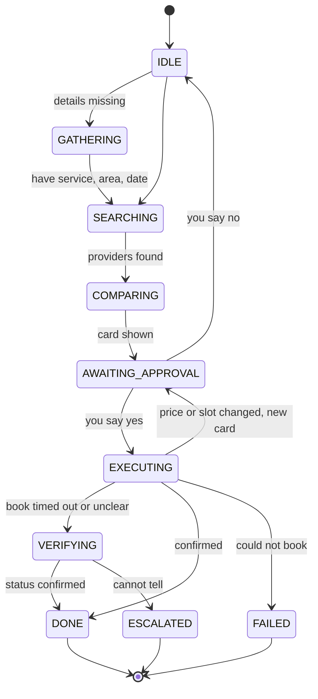

# Errand agent

A chat agent that arranges home-service errands: plumbers, electricians, AC servicing. It asks only for what is missing, compares providers, and books, cancels or reschedules only after you say yes. It runs fully on your machine against mocked providers.

Design note: [DESIGN.md](DESIGN.md) · Eval results: [EVAL_TABLE.md](EVAL_TABLE.md) · Bugs I hit: [BUGS.md](BUGS.md) · Raw trace: [traces/e2e_timeout_after_success.jsonl](traces/e2e_timeout_after_success.jsonl)

## Quick start

Python 3.12 or newer.

```bash
uv venv && source .venv/bin/activate
uv pip install -e .            # or: python -m venv .venv && pip install -e .
```

Shortcuts (a `Makefile` wraps everything below): `make setup` (venv + install), `make test`, `make evals`, `make demo` (offline, reset, `timeout_booked` scenario), `make demo-live`, `make sweep` (invariant sweep), `make trace` (regenerate the saved example trace).

Offline demo (no network, no keys, deterministic):

```bash
python -m errand_agent --scripted --reset
```

You get a two-pane screen: chat on the left, live trace on the right. Add `--plain` for a simple terminal chat (the trace then goes to `runs/<run_id>.jsonl`; `tail -f` it).

Live, with a real model:

```bash
claude setup-token                       # prints a token for your Claude subscription
export CLAUDE_CODE_OAUTH_TOKEN=...       # or put it in a .env file
# or: export ANTHROPIC_API_KEY=...
python -m errand_agent --reset
```

If `ANTHROPIC_API_KEY` is set it is used first; otherwise the OAuth token. With neither set, the CLI exits and tells you to use `--scripted`. A `.env` file in the current directory is read for these. `CLAUDE_CODE_OAUTH_TOKEN` (from `claude setup-token`) uses a Claude subscription; `ANTHROPIC_API_KEY` uses API billing.

Try these prompts:

- `plumber, Monday morning, under Rs 1500`, then `yes`
- `move my AC servicing to Saturday`
- `book the same electrician as last time, not before 10am`
- `kal subah plumber chahiye, 1500 tak` (Hinglish works for the common cases)

Force a failure with `--scenario`: `timeout_booked`, `timeout_not_booked`, `slot_taken`, `hold_expired`, `price_drift`, `slot_conflict`, `transient_error`, `injection`, `happy`. For example `--scenario timeout_booked` makes the first `book` call time out even though the booking went through. The agent checks, finds it, and tells you it is booked once.

Slash commands in the chat:

| command | what it does |
|---|---|
| `/memory` | show what the agent remembers about you |
| `/forget <key>` | forget one fact (`forget my dog` in plain words works too) |
| `/cancel-provider <booking_id>` | simulate the provider cancelling, e.g. `bk_seed_4` |
| `/events` | check for provider events now (the next message also checks) |
| `/bottom` | back to the normal two-pane view (after `/trace` or `/chat`); older output: scroll the terminal itself |
| `/trace [N]` | show the last N trace events (default 5) in full JSON in the trace pane |
| `/chat` | show the whole chat history (the terminal scrollback also works) |
| `/help`, `/quit` | on quit, the JSONL trace path and the chat transcript are printed (also saved to `runs/<id>.chat.txt`) |

Tip: to see anything cut off: `/trace 5`, or open `runs/<id>.jsonl`.

Proactive demo: `/cancel-provider bk_seed_4`, then `/events`. The agent tells you, finds a replacement that fits your saved preferences, and waits for a fresh yes.

## How it works

```
 you ──> router (plain code: intent + slots, saved in SQLite)
              │
              ▼
        context builder (4,000-token cap, only relevant, current memories)
              │
              ▼
        model: reads, then PROPOSES an action       <- cannot book, cancel or move anything
              │
              ▼
   approval card (hash saved) ──> you reply "yes" ──> approval gate (code)
                                                          │ checks: your words, the card you saw,
                                                          │ not expired, card unchanged
                                                          ▼
                                    executor: re-checks the world, idempotency key,
                                    retries, verifies via get_booking_status
                                                          │
                                                          ▼
                                                    mock tools
```

### The workflow states

Every request moves through these saved states (`errand_agent/state.py`). The model can only reach `EXECUTING` through your yes.



In one line: `IDLE -> GATHERING -> SEARCHING -> COMPARING -> AWAITING_APPROVAL -> (your yes) EXECUTING -> VERIFYING -> DONE`, with `FAILED` or `ESCALATED` as the exits when something goes wrong.

The model only has read tools and "propose" tools. Booking, cancelling and rescheduling live in the executor, which the approval gate alone can reach. See [DESIGN.md](DESIGN.md) for details.

## What is real and what is mocked

| real | mocked |
|---|---|
| the agent loop, state machine, approval gate, executor, memory, tracing, context budget | the eight provider tools (`search_providers`, `get_provider`, `hold_slot`, `book`, `get_booking_status`, `cancel`, `reschedule`, `list_bookings`), in `errand_agent/mocks/` |
| SQLite storage that survives restarts | providers, prices, reviews (some contain injection attempts), provider-cancellation events |
| the live model call (Claude, when you give it a token or key) | payments (none exist) |
| | the offline "model" used in tests and `--scripted` (a deterministic script, not an LLM) |

Mock failure behaviour follows a fixed contract: `book` succeeds, loses the slot, or times out (half of those timeouts actually booked). The first `cancel` returns a 503. Holds last 10 minutes. Outcomes can be forced per scenario so tests are reproducible.

## Guarantees

- **Nothing happens without your yes.** The model cannot call `book`, `cancel` or `reschedule`. Only the approval gate can start the executor, and only after your own reply.
- **Your yes applies to the card you saw.** A yes cannot approve a card created after your last reply. Cards expire after 30 minutes.
- **No double bookings.** One idempotency key per approved action, saved before the call. Repeated yes, retries and restarts reuse it. The executor also refuses a second booking of the same provider and slot.
- **No success claims without proof.** After a timeout the agent asks `get_booking_status`. If it cannot find out, it says so and marks the action unknown.
- **Reviews are data, not instructions.** Tool output is wrapped as untrusted text, and the code, not the model, decides what needs approval. Ranking ignores review text.
- **Hard limits.** 6 model turns, 10 tool calls, 90 seconds per request (`Limits` in `errand_agent/agent.py`). Every exit gives you a plain message.

## When things fail

- **Timeout on book:** check status by key. Booked: report it. Not booked: retry with the same key. Can't tell: say so, save it as unknown, check again on next start.
- **Transient 503:** retry up to 3 times with backoff, within the time limit. Then say it is down and that nothing changed.
- **Price or slot changed after your yes:** nothing is booked. You get a new card and must say yes again.
- **Hold expired:** take a new hold. If the price differs, ask again.
- **Crash mid-booking:** on start the executor looks at unfinished actions and resolves them by key.

## Memory and privacy

Preferences are stored in a local SQLite file (`state.db`, git-ignored), marked explicit or inferred. Ask "what do you remember about me" or `/memory` to see them; explicit facts and unconfirmed guesses are listed separately. Say `forget <topic>` to remove one. Say `remember ...` to add one. Forgotten facts and unconfirmed guesses are never sent to the model, including after a restart. Only memories that matter for the current request are sent. Each proposal has a "Why:" line that cites the memories it used.

Forgetting is a soft delete: the row stays locally so the log can show what was removed. It is never used again. Traces redact obvious secrets.

## Tests and evals

```bash
python -m pytest            # 114 unit/integration tests
python -m pytest evals      # 51 scenarios; regenerates EVAL_TABLE.md
```

Both run offline in about a second (`make test`, `make evals`).

**Invariant sweep.** `make sweep` (or `python scripts/check_invariants.py 500`) runs 500 seeded random scenarios through the real loop (forced timeouts booked and not booked, slot taken, 503s, price drift, hold expiry, repeated yes, injection reviews, forgets, restarts) and checks: no book/cancel/reschedule without a matching approved card, no success claim before a verified status, at most one booking per provider and slot, context never over the cap, forgotten facts never sent to the model. `evals/test_invariants_sweep.py` runs 100 of them in pytest. Result: seeds 0-99 give `100 runs, 0 violations`; the 500-run sweep finds 1 violation (seed 252, still open): after `what do you remember about me` and then `forget my dog`, the earlier memory listing stays in the chat history sent to the model, so the forgotten fact's text still reaches it. The evals drive the real agent loop with a scripted model, forced mock outcomes and a fake clock, and assert on outcomes and invariants (for example "no book call without a valid approval"), not on reply wording. Results are in [EVAL_TABLE.md](EVAL_TABLE.md), which the test run generates.

## Repo map

```
errand_agent/
  agent.py      main loop, limits, proactive events
  router.py     intent and slot extraction (plain code, English + some Hinglish)
  state.py      workflow state machine and slots
  approval.py   action cards, hashes, the approval gate
  executor.py   idempotency, retries, verification, recovery
  context.py    token-capped context and untrusted-output wrapping
  memory.py     explicit/inferred facts, inspect, correct, forget
  ranking.py    provider ranking (price, rating, fit, your preferences)
  models.py     scripted model, Claude Agent SDK and Anthropic API adapters
  trace.py      JSONL trace, token and cost summary
  ui.py         two-pane terminal UI
  mocks/        the provider tools
tests/          unit and integration tests
evals/          scenario evals; writes EVAL_TABLE.md
scripts/make_e2e_trace.py   regenerates traces/e2e_timeout_after_success.jsonl
```

## Limits, and what I'd do next

Honest limits:

- Intent and slot extraction is regex-based. It handles the demo prompts and some Hinglish, not free-form language. The live model handles the open-ended conversation.
- The approval hash only detects tampering with a stored card. Whether the world changed (price, slot, booking status) is caught by re-checks in the executor just before it acts.
- One user, one workflow at a time, SQLite, no auth.
- The offline evals use a scripted model, so they do not measure how well the live model understands requests.
- Dates are relative to the mock calendar (the demo data starts Monday 9 Nov 2026).

Next:

- A WhatsApp channel. The core already takes a text in and returns a text, so a webhook adapter should be thin. Replies are already short and plain.
- Payments through the same approval gate: the card would show the amount and payee, and the gate and idempotency key work the same.
- Spending limits: a per-action and per-day cap enforced in code, with extra confirmation above it.
- A proper audit log: append-only, one line per approval and money-affecting call, kept apart from debug traces.
- A larger set of recorded live-model runs to replay in the evals.

## Why this matters to me

Handing real decisions, and eventually real money, to an assistant only works if people can trust it. For that, a calm "you're not double-charged" has to be a fact the code can prove, not a nice sentence from a model. I built the errand version first because the shape is the same: ask, propose, get a yes, act once, verify, say what happened.

## Extras

- Demo video: <link>
